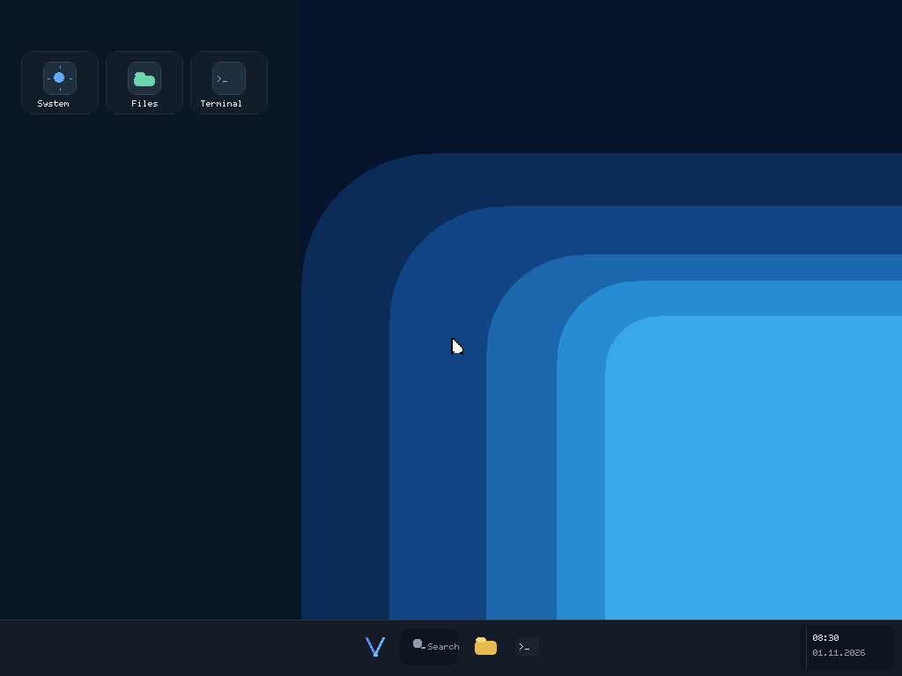
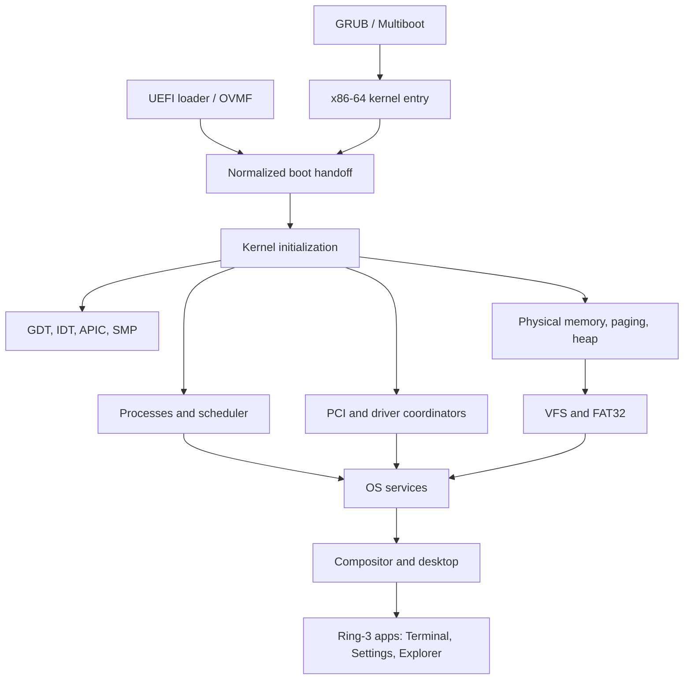

<div align="center">

# VantaOS

**A from-scratch x86-64 operating system, written in C and NASM.**

[](https://github.com/ItsDropper/VantaOS/actions/workflows/build.yml)
[](LICENSE)




</div>

VantaOS is a hobby operating system built to learn and validate OS fundamentals the hard way: boot and interrupt handling, memory management, scheduling across CPUs, ring-3 processes, a filesystem, and a graphical shell. It boots through GRUB or UEFI, runs on multiple CPUs, loads user programs as ELF binaries into private address spaces, and draws its own desktop.

> **This is an engineering prototype, not a production OS or a Windows replacement.** Features differ a lot in maturity, and the project deliberately separates *implemented*, *tested*, *verified*, and *planned*. If a capability is not listed as exercised by CI, assume it is not proven. See [Status](#status).

## Contents

- [Quick start](#quick-start)
- [Status](#status)
- [What is inside](#what-is-inside)
- [Architecture](#architecture)
- [Repository layout](#repository-layout)
- [Building, testing, and CI](#building-testing-and-ci)
- [Installer (experimental)](#installer-experimental)
- [Documentation](#documentation)
- [Contributing](#contributing)

## Quick start

Requires Linux (CI runs on Ubuntu). On Debian/Ubuntu:

```sh
sudo apt-get update
sudo apt-get install --yes build-essential nasm grub-pc-bin xorriso mtools dosfstools qemu-system-x86 gnu-efi ovmf gdisk

git clone https://github.com/ItsDropper/VantaOS.git
cd VantaOS
chmod +x build.sh run.sh
./build.sh      # kernel.bin, VantaOS.iso, vantaos.img (128 MiB FAT32 disk)
./run.sh        # boots the ISO in QEMU
```

`vantaos.img` is disposable development data; never keep anything important in it.

`run.sh` picks the fastest accelerator your host offers (KVM, HVF, WHPX, or software TCG) and can be tuned with environment variables:

| Variable | Default | Meaning |
| --- | --- | --- |
| `VANTAOS_CPUS` | `4` | Virtual CPUs (1 to 32) |
| `VANTAOS_MEMORY` | `512M` | Guest RAM |
| `VANTAOS_ACCEL` | `auto` | `kvm`, `hvf`, `whpx`, or `tcg` |
| `VANTAOS_CPU` | `host` / `max` | QEMU CPU model |

For example, `VANTAOS_CPUS=1 VANTAOS_MEMORY=256M ./run.sh` boots a small single-CPU guest.

## Status

Source presence is not proof of completion. This table summarizes what each area does today; the linked documents give the exact assertions and their limits.

| Area | What works | Not established |
| --- | --- | --- |
| **Boot** | GRUB/Multiboot and the separate x86-64 UEFI loader both reach the kernel through one normalized boot-info handoff; OVMF smoke tests exercise the UEFI path. | Physical-firmware compatibility and a polished native boot manager. |
| **Memory** | Physical memory manager, paging, heap, NX-protected user mappings, cross-CPU TLB shootdowns. | Demand paging, mature virtual-memory policy, exhaustive fault testing. |
| **CPUs** | APIC/x2APIC, secondary-CPU startup, per-CPU scheduling and wakeups, QEMU regressions at 1, 2, and 4 vCPUs. | General race freedom and long-duration stability. |
| **User mode** | Static ELF64 programs load from FAT32 into private address spaces and run at ring 3 over an `int 0x80` ABI (spawn/wait, bounded file descriptors, terminal input, GUI windows). | A stable ABI (today it is a bring-up interface), dynamic linking, broad adversarial isolation testing. |
| **Storage** | VFS plus FAT32: bounded file create/write, ASCII long filenames, directories, rename/delete, multi-cluster I/O, all covered by QEMU regression tests. | Crash-atomic replacement, Unicode filename creation, concurrent mutation, corruption recovery. |
| **Desktop** | Kernel-owned compositor; Terminal, Settings, and File Explorer run as ring-3 apps (Notes and Calculator ship as ELF apps too). Explorer has multi-select, search, recursive copy/move, and `.VZA` archive compression. | Pixel-level visual regression and scripted interaction tests. |
| **Networking** | A network stack with Ethernet, ARP, IPv4/IPv6, UDP, DHCP, DNS, and TCP, plus a plain-HTTP `curl`. | HTTPS (so the Vanta Launcher cannot yet download itself), audio, broad NIC and Wi-Fi hardware coverage. |
| **Drivers** | PCI, PS/2, xHCI/USB, ATA, AHCI, NVMe, and several NIC and Wi-Fi drivers are in the tree with host and QEMU tests. | Real-hardware validation varies by driver; see [Hardware support](docs/project/HARDWARE_SUPPORT.md). |
| **GPU** | A vendor-neutral GPU framework and bounded NVIDIA (NVX) GA10x firmware parsers with host tests. | Any verified hardware bring-up or accelerated rendering. |

Running the [Vanta Launcher](https://github.com/ItsDropper/Vanta) (the JavaFX Minecraft launcher) on VantaOS is a long-term target. It needs HTTPS, a larger userspace runtime, and a JVM first; see the [compatibility milestones](docs/VANTA_LAUNCHER_COMPATIBILITY.md).

## What is inside

- **Two boot paths** that converge on one handoff contract, both exercised in CI.
- **Multi-CPU kernel** with per-CPU state, an ownership-checked process table, ticket spinlocks, wait queues, mutexes, semaphores, barriers, and kernel events.
- **Ring-3 processes** with private page tables, a bounded syscall surface, and kernel-side validation of every user pointer.
- **FAT32 on top of a VFS**, backed by an abstract block-device layer (ATA, AHCI, NVMe, partitions).
- **A graphical desktop** with a taskbar, kernel-managed windows, themes, and ring-3 applications, plus a ring-3 terminal shell.
- **Kernel diagnostics**: serial logging, a trace-event ring, a watchdog, a graphical panic screen, and an optional recovery environment.
- **Machine-checked contracts**: CI scripts compare the public syscall table with the kernel's dispatch, and an architecture checker enforces subsystem ownership boundaries.

## Architecture



The diagram shows intended subsystem relationships, not independent protection domains. The [architecture overview](docs/architecture/ARCHITECTURE.md) walks through the boot sequence step by step, and the [decision records](docs/decisions/README.md) explain why the long-lived choices were made.

## Repository layout

| Path | Responsibility |
| --- | --- |
| `arch/x86_64/` | Long-mode entry, GDT/IDT, interrupts, APIC, ACPI/AML, SMP trampoline, CPU features. |
| `arch/x86/` | Legacy 32-bit sources kept for audit; not linked. |
| `boot/` | UEFI loader and boot-time configuration. |
| `kernel/` | Boot orchestration, syscalls, IPC, SMP, tracing, watchdog; `proc/` (process lifecycle), `sched/`, `time/`, `graphics/` (compositor and GUI server), `selftest/`. |
| `mm/` | Physical memory, paging, heap, user mappings, DMA/MMIO, TLB shootdowns. |
| `drivers/` | Input, PCI, USB, storage, network, audio, and GPU drivers (`gpu/` holds the framework and the NVX, Intel, and AMD work). |
| `net/` | Network device registry and protocol stack. |
| `fs/` | Filesystem namespace, VFS handles, FAT32 and long-filename parsing. |
| `os/` | In-kernel terminal and shell, desktop, file explorer, and test-only selftests. |
| `userspace/` | Ring-3 C runtime, headers, and the Terminal, Settings, Explorer, Notes, and Calculator apps. |
| `include/` | Shared kernel interfaces. |
| `scripts/`, `tests/` | Host-side tests, stubs, CI helpers, and user-mode test programs. |
| `docs/` | Architecture, build, testing, GPU, networking, and project documentation. |
| `.github/` | CI workflows and contribution templates. |

## Building, testing, and CI

```sh
make                       # build the kernel
make list-sources          # show the resolved source list
make clean
VANTAOS_SELF_TEST=1 ./build.sh   # build with the in-kernel self-test probes enabled
```

Objects and dependency files go under `build/obj/`; never edit generated files. See [Build system](docs/build/BUILD_SYSTEM.md).

Host-side tests compile single subsystems with the system GCC, for example:

```sh
python3 scripts/check_architecture.py
python3 scripts/check_syscall_abi.py
gcc -std=gnu11 -O2 -Wall -Wextra -Werror -Iscripts/test_stubs_smp -Iinclude \
    scripts/test_vfs_handles.c fs/vfs.c -lpthread -o /tmp/vfs-test && /tmp/vfs-test
```

GitHub Actions builds everything from a clean checkout, boots the ISO headless in QEMU at several RAM and CPU configurations, and exercises the UEFI image under OVMF. The separate [safe UEFI hardware-test workflow](.github/workflows/hardware-boot-media.yml) validates a non-installing GPT/FAT32 test image, boots it with no writable disk attached, and publishes a SHA-256 manifest with the artifact. UEFI live boots also force all registered block devices read-only. A passing marker means only that its listed assertions passed. [Testing](docs/build/TESTING.md) documents each check and its limits, including what is **not** covered.

## First physical hardware test\n\nFor a non-installing UEFI boot from a separate USB device, use the [first controlled hardware boot procedure](docs/project/FIRST_HARDWARE_BOOT.md) and the **VantaOS safe UEFI hardware test media** Actions workflow. Use the `VantaOS-UEFI.img` artifact, not the installer image. The UEFI live-boot storage policy rejects writes to every disk exposed through the common block-device layer. Keep the internal Windows drive untouched; physical firmware compatibility has not yet been demonstrated.\n\n## Installer (experimental)

The build also produces `VantaOS-Setup.img`, a **UEFI-only** installer medium (published by CI as the `vantaos-install-media` artifact). Its setup wizard preflights its payload, lets you choose a device name, EFI partition size (256 or 512 MiB), theme, accent color, Explorer density, text size, and high contrast, then shows a review screen and an exact target-disk preview. It excludes its own media from the target list and requires typing `INSTALL` before writing anything. It creates a GPT with an EFI System Partition and a FAT32 system partition, verifies the filesystem metadata, and copies the loader, kernel, apps, and settings.

> **Use only a disposable disk or a QEMU image** until you have verified the installer on your own hardware.

Current limits: language, keyboard, and time-zone choices are saved to `/SYSTEM/SETUP.CFG` as metadata only and do not yet change the running desktop, input map, or clock. Legacy BIOS setup is not supported.

## Documentation

Start at the [documentation index](docs/README.md).

| Topic | Read |
| --- | --- |
| How the system fits together | [Architecture](docs/architecture/ARCHITECTURE.md), [engineering model](docs/architecture/ENGINEERING_MODEL.md), [decision records](docs/decisions/README.md) |
| User mode and the desktop | [User-mode programs](docs/architecture/user-mode-programs.md), [User-space desktop apps](docs/architecture/USERSPACE_GUI.md), [Compositor](docs/architecture/COMPOSITOR.md) |
| Building and verifying | [Build system](docs/build/BUILD_SYSTEM.md), [Testing](docs/build/TESTING.md), [Recovery environment](docs/build/RECOVERY_SETUP.md) |
| Hardware and drivers | [Hardware support](docs/project/HARDWARE_SUPPORT.md), [GPU drivers](docs/gpu/README.md), [Networking](docs/NETWORKING.md) |
| Plans and priorities | [Development plan](docs/project/DEVELOPMENT_PLAN.md), [Bootloader plan](docs/project/BOOTLOADER_PLAN.md) |

## Contributing

Contributions that improve a verifiable subsystem are welcome. In short:

1. Work on a focused topic branch from an up-to-date `master`.
2. Build and run the relevant regression tests before requesting review.
3. Preserve the diagnostic markers CI depends on, and emit a success marker only after its assertions pass.
4. Document subsystem contracts when you change boot, memory, process, filesystem, or cross-CPU behavior.
5. Keep documentation honest: separate implemented, tested, verified, and planned.

See [CONTRIBUTING.md](CONTRIBUTING.md) for the full workflow and review checklist, [SECURITY.md](SECURITY.md) to report a vulnerability, and the [Code of Conduct](CODE_OF_CONDUCT.md).

VantaOS is released under the [MIT License](LICENSE).
