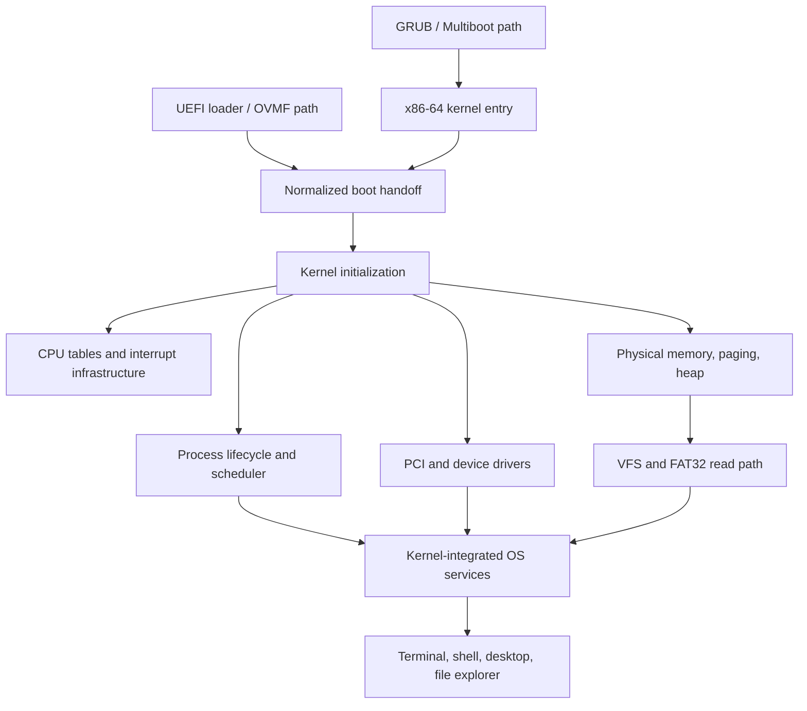

# Architecture overview

This document describes the current prototype, not a promise that every subsystem is production-ready. For verification levels and the expectations used when changing subsystem contracts, see the [engineering model](ENGINEERING_MODEL.md).

## System boundary map

The current design has two boot paths under development that converge on the kernel's normalized handoff contract. The desktop and shell are kernel-integrated components; they are not user-space applications running behind a security boundary.

The diagram expresses intended subsystem relationships, not independent protection domains or a claim that every path is equally mature. GRUB remains the established fallback; UEFI/OVMF is exercised separately by CI. See the [bootloader plan](BOOTLOADER_PLAN.md).

## Boot and initialization

1. On the GRUB path, GRUB loads the kernel through the Multiboot-compatible entry in `arch/x86_64/boot/boot.asm`, which creates early page tables, enters long mode, and transfers control to the kernel. VantaOS does not yet have its own bootloader.
2. The UEFI path uses a separate EFI loader and kernel handoff. The OVMF regression checks loader execution, ELF loading, `ExitBootServices`, kernel entry, and the normalized handoff.
3. `kernel/kernel.c` initializes serial diagnostics, GDT, physical-memory bookkeeping, interrupt infrastructure, paging, PCI/ATA discovery, and heap.
4. `os/os.c` initializes terminal/input, graphics, filesystem/VFS, process management, scheduler, shell, and desktop components.
5. The OS draws an initial desktop frame, enables interrupts, writes `VANTAOS_BOOT_OK` to serial, and enters the desktop process loop.

The two boot paths are not interchangeable evidence: a successful GRUB boot does not prove the UEFI path, and a successful OVMF boot does not prove physical firmware compatibility.

## Main source areas

| Path | Responsibility |
| --- | --- |
| `arch/x86_64/` | Active long-mode GDT, IDT, interrupt entry/dispatch, PIC, and boot code. |
| `arch/x86/` | Legacy 32-bit source retained for audit; not linked into the active target. |
| `boot/` | Boot-related assets and configuration. |
| `kernel/` | Boot orchestration, serial diagnostics, panic/fault tracing, and shared kernel services. |
| `kernel/selftest/` | Test-only boot-info/PMM and paging/spinlock regression probes. |
| `kernel/proc/` | `process.c` owns table initialization/creation; `process_context.c` owns atomic CPU claims and context-switch transitions; `process_lifecycle.c` owns wake/block/terminate/reap and snapshots. `process_internal.h` is private shared state, not a public API. |
| `kernel/sched/` | Ready-process selection and scheduling. |
| `kernel/time/` | Timer subsystem. |
| `mm/` | Heap, physical-memory bookkeeping, address-space/page-table management, user mappings, and TLB shootdown coordination. |
| `mm/tlb_shootdown.c` | Serialized cross-CPU invalidation requests, acknowledgement handling, and fail-closed diagnostics. |
| `mm/user_mapping.c` | User page-table allocation/walking and validated map/unmap lifecycle. |
| `mm/paging_internal.h` | Private paging implementation contract shared by paging modules. |
| `drivers/` | Keyboard/mouse input, PCI enumeration, and ATA storage driver code. |
| `fs/` | Filesystem namespace, FAT32 read path, and VFS handles. |
| `fs/fat32_lfn.c` | FAT32 long-filename sequence validation and UTF-16-to-UTF-8 decoding. |
| `os/terminal/` | Terminal, shell, and commands. |
| `os/desktop/` | Desktop and file-explorer UI. |
| `os/selftest/` | Test-only process, filesystem, allocator, and SMP regression probes; separate from boot orchestration. |
| `include/` | Shared interfaces. |
| `build/obj/` | Generated object/dependency tree; never edit generated files. |

## Processes and scheduling

The process table has fixed capacity and currently represents kernel execution contexts. Process records contain a state, name, saved stack/context, entry function, and address-space pointer. The scheduler uses timer ticks and a simple ready-process selection strategy. CI tests selected lifecycle transitions, process reaping, and SMP scheduling invariants under QEMU.

An address-space pointer is not proof of secure isolation. Current process execution is kernel-mode; per-process user permissions and a validated user-address-space boundary are not implemented. SMP test success establishes only the specific concurrency assertions exercised by those tests, not general race freedom or long-duration stability.

## Memory and paging

Paging establishes identity mappings for low memory and high virtual windows used by the heap/framebuffer. The physical memory manager consumes the versioned, normalized boot-info memory map and reserves the kernel image, legacy handoff metadata, and framebuffer. Address-space structures exist, but user mappings, permission enforcement, and safe user-pointer validation remain incomplete.

## Filesystem and VFS

The filesystem builds an in-memory namespace such as `/system`, `/home/user`, and `/etc`, and can import directory entries when FAT32 mounting succeeds. The VFS provides lookup/list/open/read/write/close interfaces and bounded open-file slots. Current filesystem create/write operations return an unsupported result; an API existing does not imply that the operation is implemented or persistent.

## Graphics and input

Graphics code draws the desktop using software primitives and consumes a framebuffer when available. Keyboard and mouse driver code exists. CI verifies selected boot and kernel invariants, not pixel-level correctness or full input behavior. This does not imply accelerated GPU support.

## Cross-subsystem contracts

Changes that cross these boundaries should be reviewed together with their callers and tests:

- **Boot information:** loaders provide normalized, versioned data; memory management must validate ranges and preserve reserved-region precedence.
- **Interrupts and SMP:** interrupt state, per-CPU ownership, atomic ordering, CPU affinity, and lock ordering must remain explicit.
- **Process lifetime:** scheduler references must not outlive process records; wakeups and affinity changes must trigger the required scheduling work.
- **Filesystem handles:** invalid handles and unsupported operations must fail explicitly; namespace visibility is not equivalent to durable storage.
- **Diagnostics:** serial markers are test interfaces. Emit a success marker only after its associated assertion passes.

These are design constraints for review, not a claim that every edge case is already proven. See [Engineering model](ENGINEERING_MODEL.md) for the review questions and [ADR-001](decisions/0001-subsystem-source-manifests-and-boot-coordinators.md) for the source-boundary rationale.

## Test-code boundaries

`kernel/kernel.c` coordinates early kernel initialization; it does not own regression fixture implementations. Kernel-only probes live in `kernel/selftest/`, grouped by the contract they exercise:

- `boot_info_selftest.c` — Multiboot normalization and PMM boot-map invariants.
- `platform_selftest.c` — spinlock primitive, TLB shootdown, user mappings, and per-CPU address-space invariants.
- `selftest.h` — explicit entry points called by the boot coordinator only when `VANTAOS_SELF_TEST` is enabled.

`os/os.c` owns OS initialization order and the long-running desktop entry path. It should coordinate subsystems, not implement their regression fixtures. Test-only code lives under `os/selftest/`, divided by responsibility:

- `process_selftest.c` — process lifecycle, API guards, and process-record invariants.
- `filesystem_selftest.c` — VFS namespace and FAT32 integration checks.
- `memory_selftest.c` — physical and heap allocator checks.
- `smp_selftest.c` — cross-CPU scheduling, wakeup, and migration probes.
- `selftest.h` — the narrow interface used by boot orchestration in explicit self-test builds.

The self-test translation units are compiled in ordinary builds too, but their implementations are gated by `VANTAOS_SELF_TEST`. Add a probe to the subsystem-specific module rather than growing `os/os.c`. Keep success markers attached to assertions and registered in CI when they are required regressions.

## Diagnostics

- COM1 serial logging is used by CI.
- Panic/fault tracing helps diagnose failures but does not replace a debugger.
- CI markers use `VANTAOS_..._OK` and `VANTAOS_..._FAIL`; logs and the exact workflow configuration determine what a passing marker establishes.
