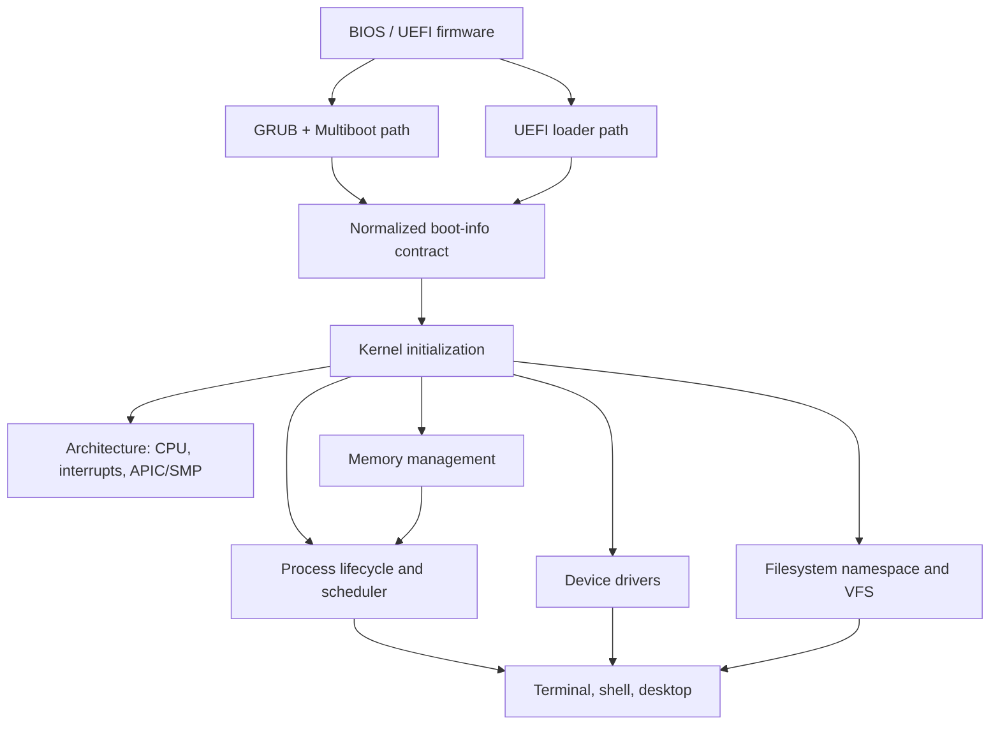

# System design

This document records the current architecture and its intended boundaries. It describes the repository as implemented today; it is not a claim that every planned subsystem exists or is complete.

## Design goals

- Keep architecture-dependent mechanisms separate from generic kernel policy.
- Keep source registration local to each subsystem while the root Makefile owns common compiler/linker rules.
- Make bootloader handoff data explicit and versioned rather than letting kernel services depend directly on firmware structures.
- Prefer observable, reproducible regression checks over unsupported claims.
- Preserve a working GRUB path while the independent UEFI path is validated.

## High-level dependency map

The diagram shows logical dependencies, not a claim that every dependency is represented by a formal interface today. The root build links a freestanding kernel; it is not a hosted application with a conventional dynamic runtime.

## Boot and initialization

There are two independently exercised entry paths:

1. **GRUB/Multiboot:** architecture assembly establishes the initial CPU state and enters long mode before calling the kernel.
2. **UEFI:** `boot/uefi/` loads the ELF64 kernel, obtains the final firmware memory map, exits boot services, and transfers control through the UEFI-specific entry.

Both paths are intended to hand the kernel a normalized, versioned boot-information structure. The kernel validates that contract before relying on its memory map and framebuffer data. GRUB remains the established fallback; passing an OVMF test is evidence for the tested handoff path, not proof of broad firmware compatibility.

The high-level initialization sequence is:

1. Establish serial diagnostics and validate boot information.
2. Initialize descriptor tables, interrupt handling, memory bookkeeping, paging, and heap.
3. Discover and initialize supported devices.
4. Initialize process management, scheduling, timers, filesystem/VFS, and OS-facing components.
5. Run selected self-tests and enter the desktop/process loop.

Exact call order is owned by the current entry and initialization code. Update this document when that order or its contracts materially change.

## Subsystem boundaries

| Subsystem | Owns | Must not be assumed |
| --- | --- | --- |
| `arch/x86_64/` | CPU-specific entry, interrupt mechanics, APIC/SMP primitives, low-level context details | General process policy or device-independent UI |
| `kernel/` | Kernel initialization, diagnostics, process lifecycle, scheduler, timer | User-mode isolation or a complete POSIX environment |
| `mm/` | Physical-memory bookkeeping, heap, paging structures | Correct user/supervisor enforcement unless separately verified |
| `drivers/` | Hardware-facing input, PCI, and ATA code | Universal device compatibility |
| `fs/` | Namespace, FAT32 read path, VFS handles | Durable create/write support |
| `os/` | Terminal, shell, desktop, file explorer | Privileged operations being safe merely because they are exposed by UI |
| `include/` | Shared declarations and explicit cross-subsystem contracts | That every header is a stable public ABI |
| Root build + subsystem manifests | Compiler/linker configuration and source membership | That an unlisted file is automatically compiled |

## SMP and scheduler model

The architecture layer provides processor startup and per-CPU primitives. The kernel scheduler owns process selection and lifecycle policy. These responsibilities are related but should not be conflated.

Engineering invariants for SMP changes:

- CPU-local data must be accessed through the appropriate CPU-local mechanism, not assumed to be globally identical.
- Shared process-table state must use its documented synchronization.
- A process's affinity and migration behavior must remain consistent with scheduler eligibility rules.
- Remote wakeups/reschedule requests must account for the target CPU's idle and interrupt state.
- Tests for concurrency must distinguish true cross-CPU overlap from repeated execution on one CPU.
- Test success markers are emitted only after all associated assertions pass.

These are review requirements, not a claim that all races or memory-ordering scenarios have been exhaustively proven.

## Memory and process trust boundaries

Current process records represent **kernel-mode execution contexts**. The existence of address-space pointers or user-mapping helpers does not establish privilege separation. Before VantaOS can claim user-mode isolation, it needs controlled privilege transitions, correct page permissions, per-process address spaces and stacks, validated syscall arguments, and tests showing that a faulting user process cannot corrupt or halt the kernel.

## Filesystem contract

The namespace and VFS provide path lookup/listing and bounded file-handle interfaces; FAT32 supplies a read-oriented storage path. Create/write behavior is not a general persistent filesystem capability today. Callers must propagate unsupported/error results rather than pretending a write succeeded.

## Build and verification boundary

Subsystem Makefiles register source files; the root Makefile owns shared flags, dependency generation, object paths, and linking. CI currently validates build artifacts, boot markers across selected QEMU memory/CPU configurations, SMP regression markers for multi-vCPU boots, and a UEFI/OVMF handoff path.

See [Testing and verification](TESTING.md) for the exact matrix. Emulator checks are not physical hardware validation, exhaustive stress testing, or a security audit.

## When to update this document

Update this design note when a change modifies:
- boot flow or the boot-information contract;
- ownership between architecture and kernel code;
- process, scheduler, memory, or filesystem interfaces;
- synchronization requirements or SMP invariants;
- the evidence needed to call a feature verified.

For decisions with lasting trade-offs, add an [architecture decision record](adr/README.md).
