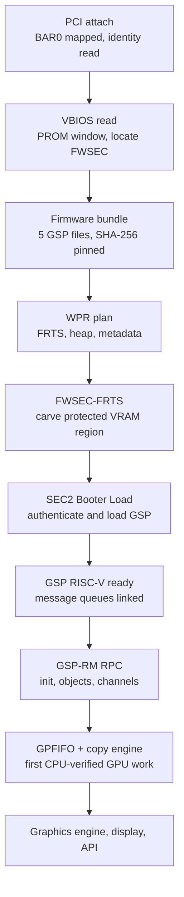

# NVX overview

Status: **implemented and host-tested; nothing is hardware-verified.** Last reviewed: 2026-11-13.

NVX is VantaOS's NVIDIA GPU driver. The current target is the GeForce RTX 3060
(GA106, Ampere/GA10x). NVX is **independently engineered**: external drivers
(Nouveau, Mesa NVK, NVIDIA's open modules) are research references only, and
every hardware fact is tracked with provenance and status. See
[Independence policy](INDEPENDENCE.md).

## What a GA10x driver must do

Ampere GPUs do not run useful work until a chain of signed, closed firmware
has been brought up in order. Each stage depends on the previous one:

## Status matrix

Evidence terms are defined in the [style guide](../../STYLE.md#status-vocabulary).

| Stage | Implemented | Host-tested | Hardware-verified | Notes |
| --- | :---: | :---: | :---: | --- |
| PCI attach, BAR0, PMC identity (`nvx status`) | yes | yes | no | Read-only |
| Register survey (`nvx survey`) | yes | yes | no | Read-only experiment feeding the knowledge base |
| VBIOS read via PROM (`nvx vbios`) | yes | yes | no | Image-chain parsing is reference-informed; E-series experiments will confirm |
| Firmware acquisition + SHA-256 manifest (`nvx fw`) | yes | yes | n/a | Proves the file is the one you pinned, not an NVIDIA signature |
| WPR/FRTS/heap policy | yes | yes | no | **Hypothesis**; NVX-F-0050/51/52 unverified |
| FWSEC-FRTS command | yes | synthetic MMIO | no | Not run on a GPU |
| SEC2 Booter Load transaction | yes | synthetic MMIO | no | Traced; recovery contract documented |
| GSP launch, MSGQ, GSP-RM init RPC | yes (callable) | mocked orchestration | no | Not wired to a shell command or boot |
| RM objects, channels, GPFIFO, copy-engine submit | yes | yes | no | ABI sizes cross-checked against public headers |
| GPUVM and DMA ownership | yes | yes | no | |
| Graphics engine, shaders, Vulkan | no | no | no | Not started |
| Display/scanout | separate software path | – | no | |

Details and the evidence each gate still needs:
[RTX 3060 readiness gates](RTX3060_READINESS.md).

## Source layout

Code lives in `drivers/gpu/nvx/` by responsibility (`core`, `firmware`, `gsp`,
`memory`, `execution`, `interrupts`). Public headers are in `include/nvx_*.h`.
See [Source layout](SOURCE_LAYOUT.md) for the map and conventions.

## Using the diagnostics

The `nvx` shell command is read-only apart from its firmware preflight, which
touches only the VFS. See [Manual bring-up commands](BRINGUP.md). To run them
against a real GPU, follow [Passthrough testing](PASSTHROUGH_TESTING.md).

## Documents by purpose

| Purpose | Document |
| --- | --- |
| Rules for hardware knowledge | [INDEPENDENCE.md](INDEPENDENCE.md), `knowledge/facts.tsv` |
| Current implementation state | [GA10X_BRINGUP.md](GA10X_BRINGUP.md), [GSP_BOOTSTRAP_GAPS.md](GSP_BOOTSTRAP_GAPS.md) |
| Orchestration | [PLATFORM_COORDINATOR.md](PLATFORM_COORDINATOR.md) |
| Firmware and VBIOS research | [FIRMWARE_REVERSE_ENGINEERING.md](FIRMWARE_REVERSE_ENGINEERING.md), [VBIOS_FWSEC_RESEARCH.md](VBIOS_FWSEC_RESEARCH.md), [VBIOS_ROM_CHAIN_RESEARCH.md](VBIOS_ROM_CHAIN_RESEARCH.md) |
| SEC2 | [SEC2_DMA_AND_RECOVERY.md](SEC2_DMA_AND_RECOVERY.md), [SEC2_TRANSACTION_TRACE.md](SEC2_TRANSACTION_TRACE.md) |
| Design record | [NVX architecture](../../NVX_ARCHITECTURE.md), [ADR-0003](../../decisions/0003-nvx-gpu-driver-architecture.md) |

## Not established

- That any NVX code path works on a physical RTX 3060.
- Correct WPR/FRTS/heap inputs for the matching firmware release.
- The GSP system-info key set and init-argument layout for a given firmware release.
- Any rendering, compute-shader or game-API capability.
